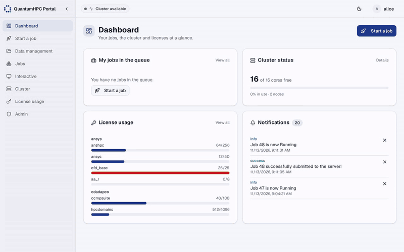
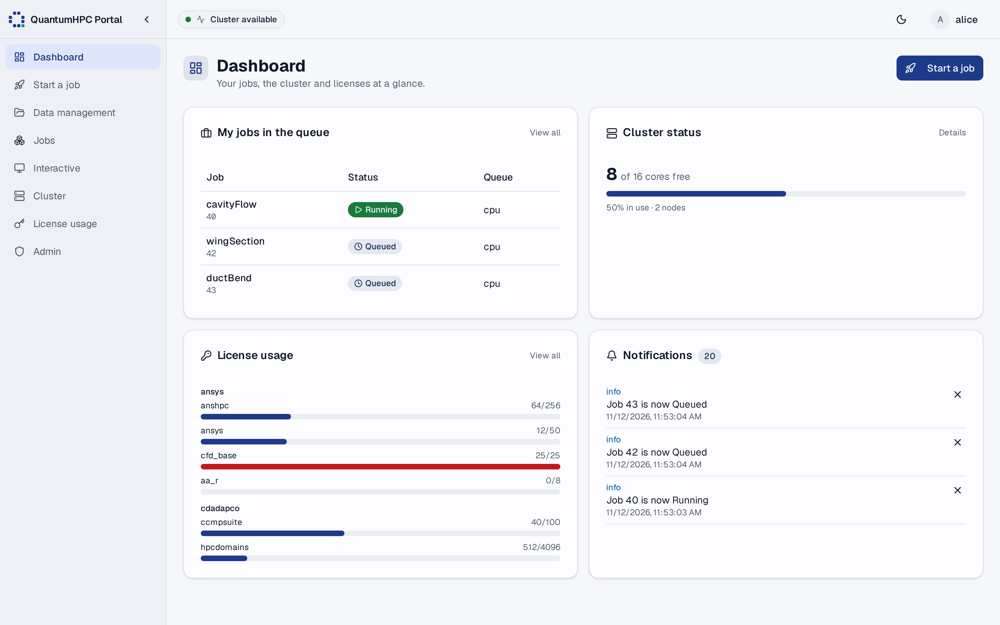
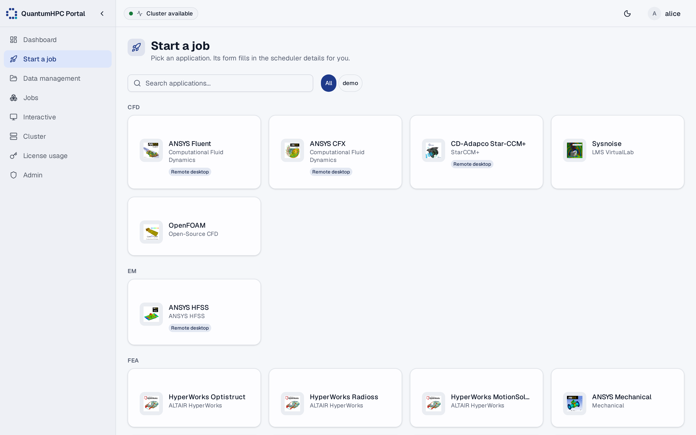
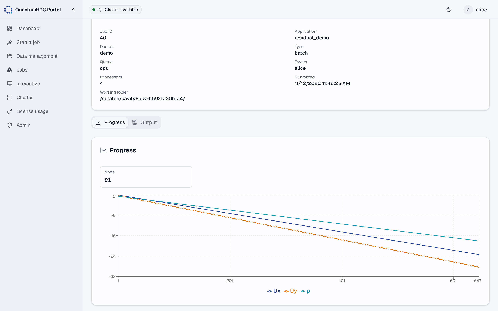
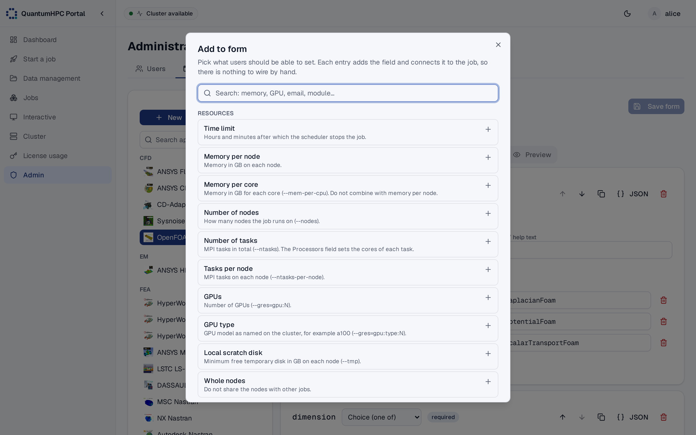
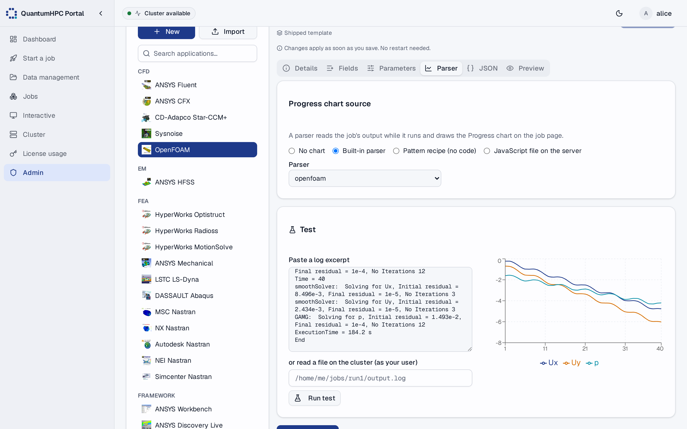

<h1 align="center">
  <picture>
    <source media="(prefers-color-scheme: dark)" srcset="public/logos/lockup-dark.svg">
    
  </picture>
</h1>

<p align="center">
  <strong>An open-source web portal for HPC clusters.</strong><br>
  Submit and monitor Slurm or PBS
  jobs, manage files, launch interactive desktops and watch software-license
  usage, all without a terminal.
</p>

<p align="center">
  <a href="https://github.com/quantumhpc/portal/actions/workflows/ci.yml"></a>
  <a href="https://github.com/quantumhpc/portal/releases"></a>
  <a href="LICENSE"></a>
  <a href="https://scorecard.dev/viewer/?uri=github.com/quantumhpc/portal"></a>
  <a href="https://quantumhpc.github.io/portal/"></a>
</p>

<p align="center">
  <a href="#quick-start">Quick start</a> ·
  <a href="docs/INSTALL.md">Install</a> ·
  <a href="docs/ADD-AN-APP.md">Add an application</a> ·
  <a href="https://quantumhpc.github.io/portal/">Documentation</a>
</p>

<picture>
  <source media="(prefers-color-scheme: dark)" srcset="docs/images/demo-cavity-dark.gif">
  
</picture>

<p align="center"><sub>A real OpenFOAM run (icoFoam, lid-driven cavity, 160×160 cells) on Slurm, started from the portal. The solver part is sped up about 15×.</sub></p>

<picture>
  <source media="(prefers-color-scheme: dark)" srcset="docs/images/dashboard-dark.png">
  
</picture>

## Features

- **Job submission from templates.** Ready-made forms for ANSYS Fluent/CFX/Mechanical,
  STAR-CCM+, Abaqus, OptiStruct, OpenFOAM and more. Add your own from the
  admin pages ([guide](docs/ADD-AN-APP.md)).
- **Job monitoring.** Queue and status, output files, solver-progress charts
  parsed from solver logs, and hold/release/cancel.
- **Cluster overview.** Nodes, partitions/queues, CPU, memory and GPU usage.
- **File manager.** Browse, upload (resumable), download (folders as tar) and
  edit files in home and scratch.
- **Interactive sessions.** Remote desktops on compute nodes (TurboVNC, TigerVNC, VirtualGL), in the browser.
- **License usage.** Live FlexLM, RLM and LM-X pool status.
- **Administration.** Users and admins, applications, progress parsers and
  site configuration from the browser, applied without a restart.
- **Secure by design.** PAM authentication (LDAP, SSSD and Kerberos all work),
  and every scheduler and file action runs as the logged-in user's uid/gid.

Supported schedulers: **Slurm** and **PBS Pro / OpenPBS**.

## Why QuantumHPC Portal

- **Easy for engineers.** Pick an application, fill a short form, watch the
  solver converge on a live chart. No scripts, no terminal, no `#SBATCH`.
- **Customised live, in the browser.** Admins add applications, build their
  forms from ready-made options (time limit, memory, GPUs, modules…), upload logos, build progress-chart parsers from patterns (no code)
  and change site settings from the admin pages. Changes apply on save, with
  no restart. Share an application with another site as one JSON file.
- **Runs as the real OS user.** Users sign in with their cluster account
  (PAM: LDAP, SSSD, Kerberos). Every job, file operation and remote desktop
  runs under their own uid/gid, so cluster permissions, quotas and
  accounting work as they already do. No service account, no user database
  to keep in sync.

## Screenshots

| | |
| --- | --- |
| <picture><source media="(prefers-color-scheme: dark)" srcset="docs/images/applications-dark.png"></picture> | <picture><source media="(prefers-color-scheme: dark)" srcset="docs/images/job-progress-dark.png"></picture> |
| **Pick an application.** Each one has a short form. | **Watch the solver converge.** The chart is read from the job output while it runs. |
| <picture><source media="(prefers-color-scheme: dark)" srcset="docs/images/admin-add-to-form-dark.png"></picture> | <picture><source media="(prefers-color-scheme: dark)" srcset="docs/images/parser-editor-dark.png"></picture> |
| **Build the form from ready-made options.** Time limit, memory, GPUs, modules and more, with nothing to wire by hand. | **Test a progress chart on a real log** before saving it. |

## Quick start

### Try the demo (one command)

```bash
docker run --rm -p 3000:3000 ghcr.io/quantumhpc/portal:demo
```

Open http://localhost:3000 and sign in as `demo` with any password. A mock
Slurm runs the jobs inside the container: start **Residual demo** and watch
its progress chart. The demo accepts any password, so never use it on a real
system.

### Install on a cluster

On a login node with the Slurm or PBS client, Node.js ≥ 20.9 and PAM
headers:

```bash
git clone https://github.com/quantumhpc/portal.git && cd portal
sudo ./deploy/install.sh --url https://portal.example.org --admin alice --start
```

Then put the portal behind TLS with the provided nginx config. The full
guide is in **[docs/INSTALL.md](docs/INSTALL.md)**.

### Try it locally (no cluster needed)

The development setup runs against bundled mock Slurm and PBS commands:

```bash
git clone https://github.com/quantumhpc/portal.git && cd portal
npm ci                # needs build tools + libpam0g-dev / pam-devel
./dev/start-dev.sh    # seeds a SQLite DB and a dev config
npm run dev           # http://localhost:3000, log in with your OS username
```

## Documentation

| | |
| --- | --- |
| [docs/INSTALL.md](docs/INSTALL.md) | Production install, reverse proxy, PAM, upgrades, troubleshooting |
| [docs/CONFIGURATION.md](docs/CONFIGURATION.md) | Every `config.json` setting and environment variable |
| [docs/ADD-AN-APP.md](docs/ADD-AN-APP.md) | Add an application in five minutes, from the browser |
| [docs/PARSERS.md](docs/PARSERS.md) | Progress-chart parsers: pattern recipes and JavaScript files |
| [docs/ARCHITECTURE.md](docs/ARCHITECTURE.md) | How the code is organised |
| [gallery/](gallery/) | Ready-made applications to import, and how to add yours |
| [dev/README.md](dev/README.md) | Mock schedulers, scenarios and dev modes |
| [CONTRIBUTING.md](CONTRIBUTING.md) | How to contribute |

## Tech stack

Next.js 16 (App Router), React 19, TypeScript, Tailwind CSS and shadcn/ui,
TanStack Query, NextAuth with PAM, and SQLite or MongoDB.

## Contributing

Contributions are welcome: bug reports, scheduler support (LSF, SGE, Flux…),
application templates, docs and code. Start with
[CONTRIBUTING.md](CONTRIBUTING.md) and look for
[`good first issue`](https://github.com/quantumhpc/portal/labels/good%20first%20issue).

Please report security issues privately, as described in
[SECURITY.md](SECURITY.md).

## License

[MIT](LICENSE). The "QuantumHPC" name and logos are trademarks, covered by
the [trademark policy](TRADEMARKS.md), not by the MIT License. Application and vendor names and logos (ANSYS, Siemens,
Dassault Systèmes, Altair and others) are trademarks of their respective
owners. They are used only to identify the software the templates launch.
