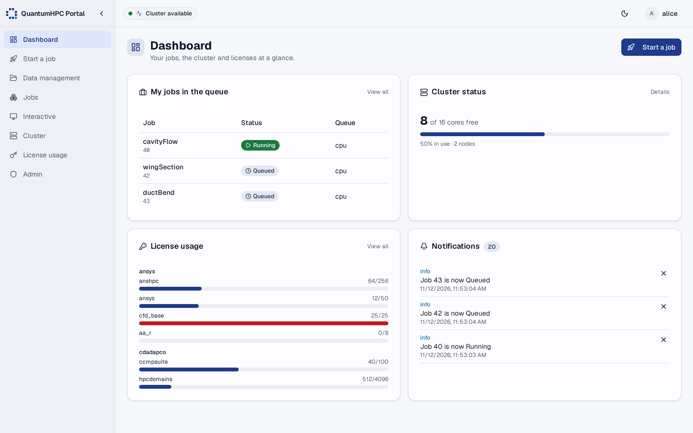

# QuantumHPC Portal

An open-source web portal for HPC clusters. Users sign in with their cluster
account to submit and monitor Slurm or PBS jobs, manage files, launch
interactive desktops and watch software-license usage, all without a terminal.

- **Easy for engineers.** Pick an application, fill a short form, watch the
  solver converge on a live chart.
- **Customised live, in the browser.** Applications, forms, logos,
  progress-chart parsers and site settings are edited from the admin pages
  and apply on save, with no restart.
- **Runs as the real OS user.** PAM sign-in, and every job, file operation
  and remote desktop runs under the user's own uid/gid.

## Run the same job again

- **Run again.** In **Jobs → My submissions**, or at the top of a job's page,
  *Run again* opens the application form filled in with that job's values.
- **Saved set-ups.** In any job form, *Save set-up* keeps the form values under
  a name. They appear at the top of **Start a job**, one click from a filled-in form.

Input files are not kept: attach them again before you submit. Saved set-ups
are private to the user who saved them.

## Guides

- **[Install](INSTALL.md)**: production install, reverse proxy, PAM, upgrades.
- **[Add an application](ADD-AN-APP.md)**: a new solver in five minutes, from the browser.
- **[Parsers](PARSERS.md)**: progress charts from pattern recipes or JavaScript.
- **[Configuration](CONFIGURATION.md)**: every `config.json` setting and environment variable.
- **[Remote desktop](remote-desktop.md)**: interactive sessions on compute nodes.
- **[Architecture](ARCHITECTURE.md)**: how the code is organised.

Source code, issues and discussions are on
[GitHub](https://github.com/quantumhpc/portal).
